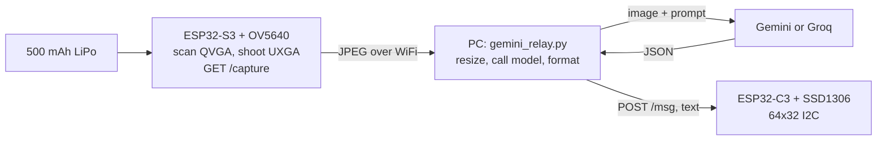

# ESP32 Gemini Cam HUD

A wireless camera rig for makers: an ESP32-S3 camera serves sharp frames over HTTP, a PC relay sends each frame to a vision model (Gemini by default) and pushes a few words of the answer to an ESP32-C3 with a 64x32 OLED.

## What was run on what

| Part | Status |
|---|---|
| PC relay (`pc/gemini_relay.py`), mock boards, tests, benchmark | Run on a Mac, 16 unit/integration tests pass. The model call is stubbed. |
| S3 camera and C3 OLED firmware (`.ino`) | **Not re-tested on hardware for this release.** The git history has no record of a flash or a bring-up. Not compiled either: `arduino-cli` is installed here but has no ESP32 core or Adafruit libraries, and the core download is several hundred MB. |
| Real Gemini and Groq calls | Not run (no paid API calls in this release). |

## Quickstart (no hardware, no key)

```
pip install pillow
python3 -m unittest discover -s pc/tests          # 16 tests
python3 scripts/bench_relay.py --out results/relay_rtt.json
```

With real boards: see sections 1-4 below.

## How it works



- The S3 scans at QVGA, never sends those frames, and judges focus by JPEG size (sharp scenes compress bigger) plus steadiness. Only then it takes one UXGA shot and holds it for `GET /capture` (503 until it has one). Tune `SHARP_MIN` with `GET /status`.
- The relay loop (every `interval_sec`): GET the frame, shrink it to `resize_width`, ask the model for JSON, format it with `display_template`, POST it to the C3. On failure it posts `LINK ERR` or `AI ERR` and keeps looping.
- ESP-NOW from S3 to C3 was dropped: a PC cannot speak it, so both boards join the PC's 2.4 GHz hotspot and use HTTP.

## Wiring

C3 pins are in `c3_oled/c3_oled.ino`; S3 camera pins are the sketch defaults for the Freenove ESP32-S3-WROOM board (unverified on hardware, a wrong pin gives "camera init failed").

| Board | Signal | GPIO | Connects to |
|---|---|---|---|
| C3 SuperMini | I2C SDA | 8 | OLED SDA |
| C3 SuperMini | I2C SCL | 9 | OLED SCL |
| C3 SuperMini | 3V3, GND | - | OLED VCC, GND (I2C address 0x3C, try 0x3D if blank) |
| S3 | XCLK | 15 | OV5640 XCLK |
| S3 | SIOD / SIOC (SCCB) | 4 / 5 | OV5640 SDA / SCL |
| S3 | D0..D7 (Y2..Y9) | 11, 9, 8, 10, 12, 18, 17, 16 | OV5640 D0..D7 |
| S3 | VSYNC / HREF / PCLK | 6 / 7 / 13 | OV5640 |
| S3 | PWDN / RESET | none (-1) | not used |
| S3 | battery ADC | none (-1) | unused; set `BATTERY_ADC_PIN` |

The camera is a ribbon plugged into the S3 board, so the S3 table only matters if your board differs.

| Part | Qty | Link |
|---|---|---|
| ESP32-S3 camera board, N16R8 (16 MB flash, 8 MB PSRAM), pinout used: Freenove ESP32-S3-WROOM | 1 | [Freenove board repo](https://github.com/Freenove/Freenove_ESP32_S3_WROOM_Board) |
| OV5640 camera module | 1 | included with the Freenove kit, otherwise any DVP OV5640 on the same ribbon |
| ESP32-C3 SuperMini | 1 | clone boards, no single official page |
| 0.49" SSD1306 OLED, 64x32, I2C | 1 | generic; library [Adafruit SSD1306](https://github.com/adafruit/Adafruit_SSD1306) + [Adafruit GFX](https://github.com/adafruit/Adafruit-GFX-Library) |
| 3.7 V 500 mAh LiPo | 1 | any with the right JST connector, check polarity |
| 2.4 GHz WiFi hotspot (PC) | 1 | ESP32 does not do 5 GHz |
| Arduino core | - | [arduino-esp32](https://github.com/espressif/arduino-esp32) |

## 1. Arduino IDE setup (once)
1. Install Arduino IDE 2.x.
2. File > Preferences > *Additional Boards Manager URLs*:
   `https://espressif.github.io/arduino-esp32/package_esp32_index.json`
3. Tools > Board > Boards Manager > install **esp32 by Espressif**.
4. Library Manager > install **Adafruit SSD1306** and **Adafruit GFX** (for the C3 only).

Wifi creds are not in the sketches. In each of `s3_cam/` and `c3_oled/`, copy
`wifi_config.example.h` to `wifi_config.h` and fill in your SSID/password.
`wifi_config.h` is gitignored, it stays local.

## 2. Flash the S3 cam  (`s3_cam/s3_cam.ino`)
- Tools settings: Board **ESP32S3 Dev Module**, **PSRAM: OPI PSRAM**, Flash Size **16MB**,
  USB CDC On Boot **Enabled**, Partition **16M Flash (3MB APP/9.9MB FATFS)**.
- **Camera pins:** the sketch defaults to the Freenove ESP32-S3-WROOM pinout. When your
  board arrives, check its pin table, if it differs, send it to me (or edit the pin
  `#define`s at the top). Wrong pins = "camera init failed".
- Plug in the OV5640 ribbon, connect USB-C, Upload. Open Serial Monitor @115200, note the IP
  (also reachable as `s3cam.local`). `http://s3cam.local/capture` returns the latest sharp shot
  (503 until it's caught one). `http://s3cam.local/status` shows the live focus number, watch
  `scan_len` while pointing at sharp vs blurry scenes and set `SHARP_MIN` between the two.
- To make the PC force a fresh sharp shot each cycle, set `s3_capture_url` to
  `http://s3cam.local/capture?fresh=1` (it waits for a new sharp frame, up to 6s).
- Battery: solder the LiPo to the board's BAT/GND pads (mind polarity). To show battery on the
  HUD, set `BATTERY_ADC_PIN` to the ADC pin your board taps the battery on.

## 3. Flash the C3 HUD  (`c3_oled/c3_oled.ino`)
- Wire the OLED: **VCC->3V3, GND->GND, SDA->GPIO8, SCL->GPIO9**.
- Tools settings: Board **ESP32C3 Dev Module**, USB CDC On Boot **Enabled**.
- Upload. The OLED should show "HUD ready" + its IP (also `c3hud.local`). If the screen
  is blank, the address may be `0x3D`, change `OLED_ADDR`.

## 4. Gemini key + PC app
1. Get an API key from Google AI Studio (aistudio.google.com > Get API key).
2. `cd pc`  then  `pip install -r requirements.txt`  (Pillow, optional but recommended).
3. `copy config.example.json config.json` and fill in `gemini_api_key`. Tweak `prompt`,
   `response_schema`, and `display_template` to whatever you want the HUD to show.
4. Run:
   ```
   python gemini_relay.py --once --preview test.jpg    # one shot, saves the frame it grabbed
   python gemini_relay.py                               # continuous, every interval_sec
   ```

## Cheaper / free inference
At a few hundred requests a day you don't need to pay. Two free options, switch with `provider` in config:

- **Gemini free tier (default):** `gemini-2.5-flash-lite` = ~1,000 req/day free, `gemini-3-flash` = ~1,500/day. Vision included, no card. Great for simple "what's in this picture" prompts.
- **Groq (`provider: "openai"`):** Llama 4 Scout, ~1,000 req/day free, vision-capable, and extremely fast. Free key at console.groq.com. It's OpenAI-compatible, the relay already handles it.

The `openai` provider also works for OpenRouter / Together / Mistral / a local server, just change `openai_base_url` + `openai_model` + `openai_api_key`. Free-tier limits/model ids drift, check the provider's dashboard for the exact current model string.

## How the display text works
Gemini returns JSON (forced via `responseMimeType`). `display_template` formats it into the
few short lines the 64x32 OLED can hold (~10 chars x 4 lines). Example:
`"{target}\nACQ {acquired}\nconf {conf}\n{note}"`. Missing keys show as `?`. No template ->
it just lists `key:value` lines.

## Tuning
- **Cost/speed:** each cycle is one Gemini vision call. `interval_sec` sets the rate;
  `resize_width` shrinks the frame before upload (fewer tokens). 3-5s is a sane start.
- **Detail vs cost:** bump `frame_size` in the S3 sketch (SVGA -> SXGA/UXGA) for more detail,
  but it costs more tokens and upload time.
- **Prompt:** this is where all the behavior lives. Ask for exactly the JSON fields your
  template uses. Keep values short, the screen is tiny.

## Results

Main metric: PC relay round trip, frame in to HUD text out, `gemini_relay.one_cycle()` with a stub camera (mock S3, a 440 KB 1600x1200 JPEG, the S3 sketch's `HQ_FRAMESIZE`) and a stub model that returns instantly. Real loopback HTTP, real Pillow resize to 1024 px, real POST. Mac (Apple Silicon, Darwin arm64, Python 3.12), 100 cycles after 5 warmup, run at background priority (`nice -n 10 taskpolicy -b`).

Command: `python3 scripts/bench_relay.py --out results/relay_rtt.json`

| Metric | Before | After | Market standard | Goal (1.5x) |
|---|---|---|---|---|
| Relay median round trip, 1024 px resize | 35.2 ms | 31.1 ms (-12%) | see below | see below |
| Same, no resize | 0.6 ms | 0.6 ms | | |

Before and after are the median of three runs each (runs ranged 35.0-40.9 and 29.6-34.3 ms; the machine was not idle, so treat the 12% as roughly 10-15%). The change is one line: bilinear resize with `reducing_gap=2.0` instead of Pillow's default bicubic. Raw files: `results/relay_rtt_before.json`, `results/relay_rtt.json`, `results/relay_rtt_noresize.json`.

**Market standard.** The comparable published numbers are for the camera, not the relay. The [ESP32-CAM benchmark paper](https://arxiv.org/abs/2505.24081) (OV2640, HTTP streaming over WiFi, all voltages pooled) reports 14.19 fps at VGA, 8.25 fps at SVGA and 1.29 fps at UXGA. That is about 70, 121 and 775 ms per frame. The paper gives no latency figures. The [MJPEG2SD README](https://www.github.com/s60sc/ESP32-CAM_MJPEG2SD) lists 12.5 fps camera-limited at UXGA. This rig takes UXGA stills, so the closest frame time is about 775 ms. The relay adds 31 ms on the PC (4% of that), so against a 1.5x goal (under 517 ms) it passes, but the comparison is loose: it leaves out WiFi transfer of the frame, the S3 capture time, the OV5640 (the paper tested the OV2640) and the model call, which will be hundreds of ms to seconds. The end-to-end rig number needs hardware and a real API key.

## Limits

- Firmware is untested on hardware and uncompiled in this environment (see the table at the top).
- The benchmark measures PC-side work only: loopback instead of WiFi, no model latency, no camera capture time. It says nothing about end-to-end speed.
- 12% is a small gain on a noisy machine, and it comes from a quality trade (bilinear instead of bicubic downscale). Gemini output quality was not compared.
- No retry or backoff for model timeouts or bad JSON; the loop logs, posts `AI ERR` and carries on.
- No per-field validation of model output before it reaches the OLED. A non-dict reply is truncated to 40 characters.
- Battery monitoring is off (`BATTERY_ADC_PIN = -1`).
- Free-tier limits and model ids in the Cheaper / free inference section drift; check the provider.

## Layout
- `s3_cam/` - ESP32-S3 sketch: blur-gated capture, WebServer endpoints, camera pins
- `c3_oled/` - ESP32-C3 sketch: OLED render loop, HTTP message receiver
- `pc/` - `gemini_relay.py`, `mock_boards.py` (stdlib HTTP stand-ins for both boards), `config.example.json`, `tests/`
- `scripts/bench_relay.py`, `results/` - the benchmark and its output

## Tests
```
python3 -m unittest discover -s pc/tests
```
Covers JSON extraction, display formatting, resize, and full relay cycles over real loopback sockets against `pc/mock_boards.py` (only the model call is mocked). `python3 pc/mock_boards.py` starts the mocks on :8091 and :8092 if you want to point `config.json` at them.

## License
MIT
